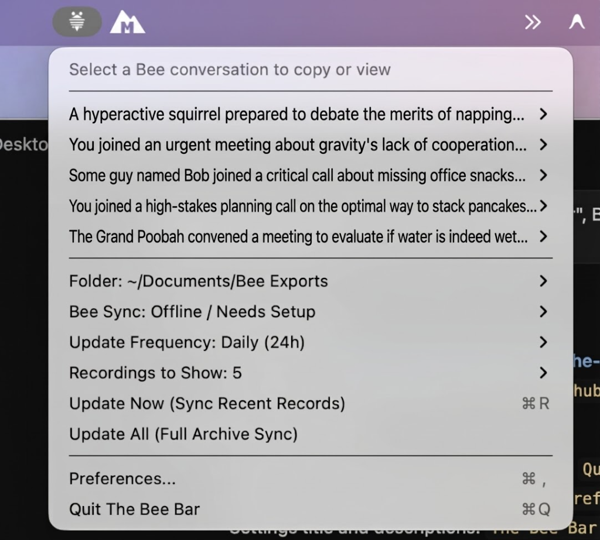

<p align="center">
  
</p>

<h1 align="center">The Bee Bar</h1>

<p align="center">
  <strong>Native macOS Menu Bar Companion and Export Utility for Bee.computer</strong>
</p>

<p align="center">
  <a href="https://github.com/joehagerman/The-Bee-Bar/releases/latest/download/The-Bee-Bar-macOS.dmg">
    
  </a>
  &nbsp;&nbsp;
  <a href="https://github.com/joehagerman/The-Bee-Bar/releases/latest/download/The-Bee-Bar-macOS.zip">
    
  </a>
</p>

<p align="center">
  
  
  
  
  
</p>

---

<p align="center">
  
</p>

---

## Overview

**The Bee Bar** is a lightweight, native macOS status bar utility designed for users of the [Bee.computer](https://bee.computer) wearable microphone and assistant.

Running quietly in the macOS menu bar (`LSUIElement`), The Bee Bar synchronizes audio recordings, conversational transcripts, executive summaries, journals, action items, and memory facts into clean local Markdown (`.md`) and raw JSON (`.json`) files. It also integrates directly with the Google Gemini API to generate customized, high-impact executive summaries with a real-time streaming telemetry terminal.

---

## Direct Download

| Format | Target Platform | Release Package |
|:---|:---|:---|
| **Apple Disk Image (.dmg)** *(Recommended)* | macOS 13.0 or later (Apple Silicon & Intel) | [**Download The-Bee-Bar-macOS.dmg**](https://github.com/joehagerman/The-Bee-Bar/releases/latest/download/The-Bee-Bar-macOS.dmg) |
| **ZIP Archive (.zip)** | macOS 13.0 or later (Apple Silicon & Intel) | [**Download The-Bee-Bar-macOS.zip**](https://github.com/joehagerman/The-Bee-Bar/releases/latest/download/The-Bee-Bar-macOS.zip) |

All official release builds and changelogs are available on the [GitHub Releases Page](https://github.com/joehagerman/The-Bee-Bar/releases).

> Note for Safari Users: By default, Safari automatically expands `.zip` files into an application bundle upon download. Downloading the **.dmg** is recommended to preserve standard drag-and-drop installation.

---

## Key Capabilities

### 1. Chronological Filesystem Alignment
- Automatically updates both the macOS file creation date (`NSFileCreationDate`) and modification date (`NSFileModificationDate`) on every downloaded Markdown document, verbatim transcript, and JSON payload to match the exact historical date and time the conversation occurred.
- Ensures macOS Finder, Spotlight, Obsidian, Logseq, and Notion view and sort all files in chronological order rather than clustering them at the time of synchronization.

### 2. Interactive Terminal Console HUD
- When invoking Gemini AI summarization, The Bee Bar presents a developer terminal console displaying real-time streaming telemetry:
  - Target conversation ID, duration, and utterance turn count.
  - Transcript payload size and system prompt injection.
  - Network request details (HTTP POST endpoint, TLS 1.3 handshake, byte transfer).
  - Inference reception, token output verification, and clipboard copy confirmation.
- **Dual Tab Switching**: Seamlessly toggle between the live **Terminal Log** and the formatted **Summary Preview** tab.
- **Auto-Dismiss Controls**: Pause the 5-second countdown timer to review summaries without rushing, re-copy with one click, or dismiss when done.

### 3. Comprehensive Executive Dossier Prompting
- Default prompt structures transcripts into an in-depth intelligence dossier:
  - **Discussion Overview & Context**: Multi-paragraph narrative synthesizing the core objectives, participant viewpoints, and trajectory.
  - **In-Depth Discussion & Core Topics**: Substantive breakdown of technical context, nuances, and arguments.
  - **Key Decisions & Strategic Takeaways**: Explicit decisions reached, underlying rationales, and evaluated alternatives.
  - **Action Items, Deliverables & Owners**: Checkbox tasks with assignees and timelines.
  - **Open Questions, Risks & Follow-ups**: Unresolved items, dependencies, and potential blockers.
- Full prompt customization with a multi-line code editor and instant "Reset to Default" button in Preferences.

### 4. Continuous Background Synchronization & Menu Limits
- Automatically polls Bee's servers at configurable intervals: 1 minute, 5 minutes, 15 minutes, Daily (24 hours), Weekly, or Manual Only.
- Configurable menu bar item limit: choose to display 5, 10, 15, 20, 25, 50, or all available conversations directly from the menu bar or Preferences.
- Maintains a local index (`metadata.json`) for instant lookup without redundant network overhead.

### 5. Dual Connection Modes & Built-in Token Extraction
- **Local Proxy Mode (Recommended)**: Automatically interfaces with `bee proxy` on `http://127.0.0.1:8787` with zero credentials needed.
- **Direct Cloud API Mode**: Connects directly to the Bee developer endpoint (`https://api.developer.bee.amazon.dev`) using Bearer token authentication.
- **Keychain Token Retrieval**: Preferences includes copyable commands to retrieve your authenticated Bearer token directly from the macOS Keychain.

### 6. One-Click Clipboard Actions & Hover Preview
- **Copy Summary**: Extracts only the clean executive summary section without verbatim audio dialogue.
- **Copy Transcript**: Copies the complete verbatim dialogue transcript directly to the clipboard.
- **Copy Gemini Summary**: Summarizes the transcript with Google Gemini, streams terminal logs, and copies the full analytical brief to the clipboard.
- **Hover Preview Panel**: Non-activating floating panel displays the full conversation summary on hover without requiring a click.

---

## Step-by-Step Installation & Setup

### Step 1: Install the Application
1. Download [**The-Bee-Bar-macOS.dmg**](https://github.com/joehagerman/The-Bee-Bar/releases/latest/download/The-Bee-Bar-macOS.dmg) (or [**The-Bee-Bar-macOS.zip**](https://github.com/joehagerman/The-Bee-Bar/releases/latest/download/The-Bee-Bar-macOS.zip)).
2. Open the disk image (or extract the zip) and drag **The Bee Bar.app** into `/Applications`.
3. Launch **The Bee Bar** from Applications or Spotlight. A striped bee icon will appear in the top-right macOS menu bar.

#### First-Launch Authorization (macOS Gatekeeper)
The Bee Bar is digitally signed with an official Apple Developer ID (`Developer ID Application: Joseph Hagerman`). When downloading applications directly from GitHub rather than the Mac App Store, macOS attaches a download quarantine flag (`com.apple.quarantine`) and prompts for confirmation on first launch:
> *"The Bee Bar" is an app downloaded from the internet. Are you sure you want to open it?*

To launch:
- Click **Open** when prompted by macOS.
- If Gatekeeper requests authorization on your macOS version: in Finder, open `/Applications`, right-click (or Control-click) **The Bee Bar**, select **Open**, and click **Open** (or in **System Settings &rarr; Privacy & Security**, click **Open Anyway**).
- Alternatively, run this terminal command to clear the quarantine flag:
  ```bash
  xattr -cr "/Applications/The Bee Bar.app"
  ```

### Step 2: Configure Bee Connection

#### Option A: Local Proxy Mode (Recommended)
1. Install the Bee CLI if not already present on your Mac:
   ```bash
   npm install -g @beeai/cli
   ```
2. Log in using the terminal QR code:
   ```bash
   bee login --qr
   ```
   Open your Bee mobile app, navigate to **Settings**, and scan the QR code displayed in your terminal.
3. Start the local proxy:
   ```bash
   bee proxy
   ```
   Keep this terminal process running.
4. Click **The Bee Bar** menu icon &rarr; **Preferences...** &rarr; select **Local Proxy (8787)**.
5. Click **Verify Connection (GET /v1/me)** to confirm pairing, then click **Save Settings**.

#### Option B: Public Cloud API Mode
1. **Extract your token from macOS Keychain** (since you already completed `bee login --qr`):
   ```bash
   security find-generic-password -s "bee-cli" -a "token:prod" -w
   ```
   *(macOS will prompt for your Mac password to grant Keychain access, then print your full token).*
   *Alternatively, in your Bee mobile app: Settings &rarr; tap version 5 times &rarr; Developer Mode &rarr; copy Bearer token.*
2. In The Bee Bar Preferences, select **Public Cloud API**.
3. Paste your token into the **Bearer Token** field.
4. Click **Verify Connection (GET /v1/me)** and click **Save Settings**.

### Step 3: Configure Google Gemini AI (Optional)
1. In Preferences, switch to the **Gemini AI** tab.
2. Enter your Google Gemini API key (obtained from [Google AI Studio](https://aistudio.google.com)).
3. Click **Fetch Models** to populate available model versions and select your preferred model (e.g. `gemini-2.5-flash`, `gemini-3.8-flash`, `gemini-2.5-pro`).
4. (Optional) Customize the Pre-Prompt instructions to tailor the tone and section headers of your executive summaries.
5. Click **Save Settings**.

---

## Local Storage Layout

All data is stored locally on your Mac (default path: `~/Documents/Bee Exports`):

```text
~/Documents/Bee Exports/
  ├── conversations/
  │     ├── conv_<id>.md         Formatted Markdown with summary and speaker dialogue
  │     ├── conv_<id>.json       Full raw JSON payload from Bee API
  │     └── conv_<id>_gemini.md  Cached Gemini AI executive summaries (timestamp-aligned)
  ├── transcripts/
  │     ├── <id>_transcript.txt  Plain-text verbatim audio transcript (timestamp-aligned)
  │     └── <id>_transcript.md  Markdown verbatim audio transcript (timestamp-aligned)
  ├── daily/
  │     ├── daily_<date>.md      Daily morning/evening recap briefs
  │     └── daily_<date>.json
  ├── journals/
  │     ├── journal_<id>.md      Reflections and journal entries
  │     └── journal_<id>.json
  ├── todos/
  │     ├── todos.md             Extracted action items checklist
  │     └── todos.json
  ├── facts/
  │     ├── facts.md             Memory bank facts summary
  │     └── facts.json
  └── metadata.json              Fast local index with parsed timestamps
```

User preferences and credentials are saved in `~/.bee-desktop/config.json` in your home directory, completely isolated from project code.

---

## Codebase Architecture & Source Reference

The source code for the native macOS application is located in `BeeBar/Sources/BeeBar/`:

| Source File | Description |
|:---|:---|
| `main.swift` | Application entry point configuring NSApplication activation policy and lifecycle. |
| `AppDelegate.swift` | Manages `NSStatusItem`, dynamic menu construction, hover tooltips, and action handlers. |
| `BeeIcon.swift` | Renders and caches the custom 22x22 template menu bar icon. |
| `BeeModels.swift` | Strongly-typed Codable structures for Bee conversations, utterances, timestamps, and metadata. |
| `BeeStore.swift` | Observable state store coordinating background sync timers and local data reloading. |
| `BeeSyncEngine.swift` | HTTP client handling Bee REST API endpoints, chronological date alignment, and file serialization. |
| `ConfigManager.swift` | Manages reading and atomic non-destructive writing of `~/.bee-desktop/config.json`. |
| `GeminiService.swift` | Client for Google Gemini generateContent with real-time logging callbacks and token limits. |
| `GeminiProgressModal.swift` | Floating HUD terminal console presenting live streaming telemetry and summary previews. |
| `SettingsView.swift` | SwiftUI preferences panel with tabbed navigation, proxy guide, Keychain helper, and pre-prompt editor. |
| `SummaryPreviewPanel.swift` | Non-activating floating panel displaying conversation summaries upon hover. |

---

## Building from Source

To compile and package The Bee Bar from source:

```bash
# Clone the repository
git clone https://github.com/joehagerman/The-Bee-Bar.git
cd The-Bee-Bar/BeeBar

# Compile production binary with Swift Package Manager
swift build -c release

# Package the standalone application bundle
./package-app.sh

# Install into /Applications
cp -R BeeBar.app "/Applications/The Bee Bar.app"
```

---

## License

This project is licensed under the [MIT License](LICENSE).
